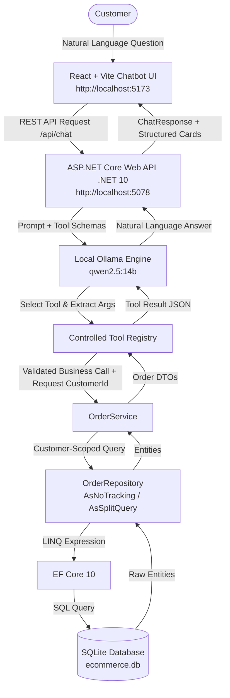

# AI-Powered E-Commerce Order Management Chatbot

A complete, locally running AI agent for e-commerce order management built from scratch.

This system allows customers to manage and inquire about their orders, shipments, line items, and payment transactions using natural language. Built with **React + Vite**, **ASP.NET Core Web API (.NET 10)**, **Entity Framework Core 10**, **SQLite**, and **Ollama (`qwen2.5:14b`)**, it demonstrates how to build an enterprise-grade AI chatbot that securely interacts with relational business data through controlled tool execution.

---

## Table of Contents

- [Project Overview](#project-overview)
- [Key Features](#key-features)
- [Architecture & Security Principles](#architecture--security-principles)
- [Technology Stack](#technology-stack)
- [Project Directory Structure](#project-directory-structure)
- [Required Installations & Prerequisites](#required-installations--prerequisites)
- [Step-by-Step Setup & Running Guide](#step-by-step-setup--running-guide)
  - [Step 1: Database Setup & Seeding](#step-1-database-setup--seeding)
  - [Step 2: Ollama Local AI Setup](#step-2-ollama-local-ai-setup)
  - [Step 3: Run the .NET 10 Web API Backend](#step-3-run-the-net-10-web-api-backend)
  - [Step 4: Run the React + Vite Frontend](#step-4-run-the-react--vite-frontend)
- [Sample Test Customers & Orders](#sample-test-customers--orders)
- [Example Queries to Try](#example-queries-to-try)
- [REST API Reference](#rest-api-reference)
- [Troubleshooting](#troubleshooting)

---

## Project Overview

Traditional e-commerce platforms force users to manually navigate multiple screens, dashboards, and carrier portals to find order statuses, tracking numbers, or transaction receipts. 

This project solves that by providing an intelligent, natural-language chatbot that:
- Understands customer questions in conversational English.
- Autonomously selects and calls the right backend business function.
- Strictly retrieves verified database records without hallucinating data.
- Formats monetary values with exact precision (using integer paise to eliminate floating-point rounding errors).
- Renders rich interactive UI cards (status badges, delivery tracking timelines, line item breakdowns).

---

## Key Features

- **100% Private, Local AI Inference**: Uses a local Ollama model (`qwen2.5:14b`) with zero dependencies on external cloud LLM APIs (no OpenAI, Anthropic, or external credits needed).
- **Controlled Backend Tool Execution**: The LLM determines the *intent* and parameters, but execution is strictly handled by strongly-typed C# backend business functions.
- **Strict Customer Isolation Boundary**: Customer identification is strictly enforced by the server context. The LLM is never allowed to inject or override `customerId`.
- **Clean Architecture**: Complete separation of concerns:
  - **Controllers**: HTTP endpoints & serialization
  - **AI Layer**: Ollama client, tool registry, and multi-turn orchestration
  - **Services**: Business logic and DTO transformations
  - **Repositories**: Isolated EF Core queries (`AsNoTracking`, `AsSplitQuery`)
  - **Entities**: Clean SQLite relational models
- **Interactive React UI**:
  - Customer switcher for immediate testing of multi-tenant boundaries
  - Collapsible order history timeline
  - Tool execution badges showing live backend function invocations
  - Quick-prompt suggestion chips

---

## Architecture & Security Principles



### Core Security Principles

1. **Zero Direct LLM Database Access**: The LLM never touches SQLite, writes SQL, or connects to a database driver. All database access is mediated through validated C# repositories.
2. **Customer Identity Protection**: `customerId` is strictly determined by the server request context and injected into repository filters (`o.CustomerId == customerId`). An LLM or untrusted request cannot access another customer's data.
3. **Factual Grounding**: The system prompt and tool execution pipeline prevent the LLM from inventing order details, tracking numbers, or statuses. If an order does not exist, it politely reports that fact.

---

## Technology Stack

| Layer | Component | Version / Choice | Purpose |
|---|---|---|---|
| **Frontend** | React | `^18.3.1` | Reactive component UI |
| | Vite | `^6.2.0` | Fast build tool and development server with API proxy |
| | Lucide React | `^1.16.0` | Icons for logistics, packages, and statuses |
| **Backend** | ASP.NET Core | `.NET 10.0` | Modern, high-performance Web API |
| | C# | `13 / 14` | Strongly-typed backend language |
| | EF Core | `10.0.0` | SQLite ORM with split queries and navigation properties |
| **Database** | SQLite | `3.x` | Relational database with integer paise and UTC timestamps |
| **Local AI** | Ollama | `Latest` | Local model runtime |
| | LLM Model | `qwen2.5:14b` | Function calling and conversational reasoning |

---

## Project Directory Structure

```text
OrderManager/
├── backend/
│   └── OrderManger.API/
│       ├── Controllers/
│       │   ├── ChatController.cs        # POST /api/chat (AI agent endpoint)
│       │   ├── OrdersController.cs      # GET /api/orders/* (Order, payment, tracking endpoints)
│       │   └── DatabaseController.cs    # GET /Database/Status (Health check)
│       ├── AI/
│       │   ├── Ollama/                  # Typed Ollama HTTP client and JSON schemas
│       │   ├── Tools/                   # Tool registry and argument dispatcher
│       │   └── ChatOrchestration/       # Multi-turn tool execution loop
│       ├── Services/
│       │   ├── Interfaces/              # IOrderService interface
│       │   └── OrderService.cs          # Business logic and entity-to-DTO mapping
│       ├── Repositories/
│       │   ├── Interfaces/              # IOrderRepository interface
│       │   └── OrderRepository.cs       # EF Core data retrieval with customer isolation
│       ├── DTOs/
│       │   ├── Orders/                  # OrderDetail, OrderSummary, Payment, Shipment DTOs
│       │   └── Chat/                    # ChatRequest and ChatResponse contracts
│       ├── Data/
│       │   ├── Entities/                # Scaffolded EF Core entities
│       │   └── OrderManagerDbContext.cs # Database context
│       ├── appsettings.json             # Database path and Ollama configuration
│       └── Program.cs                   # Service registration, CORS, and HTTP pipeline
├── frontend/
│   ├── src/
│   │   ├── components/
│   │   │   ├── Header.jsx               # Navigation bar, model badge, and customer switcher
│   │   │   ├── ChatMessage.jsx          # Message bubble with tool execution pills
│   │   │   ├── OrderCard.jsx            # Detailed order card with items & tracking
│   │   │   ├── OrderSummaryList.jsx     # Compact card list for recent/status queries
│   │   │   ├── QuickPrompts.jsx         # Clickable suggestion chips
│   │   │   └── TypingIndicator.jsx      # Animated AI reasoning dots
│   │   ├── data/
│   │   │   └── customers.js             # Sample customer metadata and prompts
│   │   ├── services/
│   │   │   └── api.js                   # Frontend API client
│   │   ├── App.jsx                      # Main chatbot container and state management
│   │   ├── index.css                    # Typography and custom styling
│   │   └── main.jsx                     # React entry point
│   ├── vite.config.js                   # Vite config with API proxy
│   └── package.json                     # Frontend dependencies
├── database/
│   ├── schema.sql                       # 7 relational table schemas with constraints
│   ├── seed.sql                         # Sample e-commerce data
│   ├── chatbot_queries.sql              # Verification SQL queries
│   └── ecommerce.db                     # SQLite database file (excluded from Git)
└── README.md
```

---

## Required Installations & Prerequisites

Before running the application, make sure the following software is installed on your development machine (macOS, Linux, or Windows):

### 1. .NET 10 SDK
Download and install the **.NET 10 SDK**:
- [https://dotnet.microsoft.com/download/dotnet/10.0](https://dotnet.microsoft.com/download/dotnet/10.0)

Verify installation in your terminal:
```bash
dotnet --version
# Should output 10.x (e.g., 10.0.201)
```

### 2. Node.js & npm
Download and install **Node.js 18+** (LTS recommended):
- [https://nodejs.org/](https://nodejs.org/)

Verify installation:
```bash
node -v   # v18.x, v20.x, or v22.x
npm -v    # 9.x or 10.x
```

### 3. SQLite3 CLI
- **macOS**: Built-in, or install via Homebrew: `brew install sqlite`
- **Ubuntu/Debian**: `sudo apt install sqlite3`
- **Windows**: Install via `winget install SQLite.SQLite` or download from [sqlite.org](https://www.sqlite.org/download.html)

### 4. Ollama Local LLM Runtime
Install Ollama:
- **macOS**: Download from [ollama.ai/download](https://ollama.ai/download) or run `brew install ollama`
- **Linux**: `curl -fsSL https://ollama.com/install.sh | sh`
- **Windows**: Download from [ollama.ai/download/windows](https://ollama.ai/download/windows)

Verify installation:
```bash
ollama --version
```

---

## Step-by-Step Setup & Running Guide

Follow these steps in order to get the entire stack up and running:

### Step 1: Database Setup & Seeding

The repository provides the schema and seed scripts under the `database/` directory.

To create or re-seed the SQLite database, open your terminal in the project root:

```bash
# Navigate to project root
cd /path/to/OrderManager

# Ensure the database directory exists
mkdir -p database

# Create schema and insert sample seed records into ecommerce.db
sqlite3 database/ecommerce.db < database/schema.sql
sqlite3 database/ecommerce.db < database/seed.sql
```

Verify that the records are populated:
```bash
sqlite3 database/ecommerce.db "SELECT OrderNumber, CustomerId, OrderStatus, printf('₹%.2f', TotalPaise / 100.0) AS Total FROM Orders;"
```

You should see 8 sample orders (delivered, shipped, confirmed, pending, processing, and cancelled).

---

### Step 2: Ollama Local AI Setup

1. **Start the Ollama daemon** (if not already running):
   ```bash
   ollama serve
   ```

2. **Pull the recommended model** (`qwen2.5:14b`):
   ```bash
   ollama pull qwen2.5:14b
   ```
   > *Note: If you have hardware resource constraints, you can also use `qwen2.5:7b`. Simply update `"Model": "qwen2.5:7b"` in `backend/OrderManger.API/appsettings.json`.*

3. **Verify that Ollama responds**:
   ```bash
   curl http://localhost:11434/api/tags
   ```

---

### Step 3: Run the .NET 10 Web API Backend

1. Navigate to the backend directory:
   ```bash
   cd backend/OrderManger.API
   ```

2. Restore packages and build:
   ```bash
   dotnet build
   ```

3. Start the Web API server:
   ```bash
   dotnet run
   ```

The backend API will start and listen on:
- **HTTP**: `http://localhost:5078`
- **Database Status**: `http://localhost:5078/Database/Status`
- **OpenAPI Schema**: `http://localhost:5078/openapi/v1.json`

Verify backend connectivity in a separate terminal:
```bash
curl -s http://localhost:5078/Database/Status
# Expected response: {"message":"Database connected successfully","database":"SQlite","totalCustomers":5}
```

---

### Step 4: Run the React + Vite Frontend

1. Open a new terminal and navigate to the frontend directory:
   ```bash
   cd frontend
   ```

2. Install dependencies:
   ```bash
   npm install
   ```

3. Start the development server:
   ```bash
   npm run dev
   ```

4. Open your browser to:
   👉 **[http://localhost:5173](http://localhost:5173)**

---

## Sample Test Customers & Orders

You can switch customers using the dropdown in the top-right header of the UI to test data isolation and different order scenarios:

| Customer ID | Code | Name | Location | Orders & Statuses in Database |
|---|---|---|---|---|
| **1** | `CUST-1001` | **Aarav Sharma** | Viman Nagar, Pune | `ORD-2026-1002` (Shipped via Delhivery)<br>`ORD-2026-1001` (Delivered via BlueDart) |
| **2** | `CUST-1002` | **Priya Deshmukh** | Baner, Pune | `ORD-2026-1003` (Confirmed)<br>`ORD-2026-1004` (Pending) |
| **3** | `CUST-1003` | **Rohan Patil** | Kothrud, Pune | `ORD-2026-1005` (Delivered)<br>`ORD-2026-1008` (Processing) |
| **4** | `CUST-1004` | **Neha Kulkarni** | Wakad, Pune | `ORD-2026-1006` (Cancelled) |
| **5** | `CUST-1005` | **Aditya Joshi** | Hinjewadi, Pune | `ORD-2026-1007` (Shipped) |

---

## Example Queries to Try

Type these into the chatbox or click the suggestion chips:

### 1. Shipment Tracking
> *"Where is my order ORD-2026-1002?"*  
> **Backend Tool Invoked:** `get_shipment_tracking`  
> **Result:** Reports carrier (Delhivery), tracking number (`DL123456789`), in-transit status, ETA, and clickable tracking link.

### 2. Recent Orders
> *"Show me all my recent orders."*  
> **Backend Tool Invoked:** `get_recent_orders`  
> **Result:** Returns an interactive list of all recent orders belonging to the active customer.

### 3. Product Breakdown
> *"What products did I purchase in ORD-2026-1002?"*  
> **Backend Tool Invoked:** `get_order_items`  
> **Result:** Returns Mechanical Keyboard (1 × ₹3,499) and USB-C Hub (1 × ₹1,499).

### 4. Payment Verification
> *"Is my payment successful for ORD-2026-1002?"*  
> **Backend Tool Invoked:** `get_payment_details`  
> **Result:** Returns payment status `Paid`, payment method `CreditCard`, amount `₹5,996.64`, and reference `PAY-1002`.

### 5. Status Filtering
> *"Do I have any pending orders?"*  
> **Backend Tool Invoked:** `get_orders_by_status` (status: "Pending")  
> **Result:** If customer 2 is selected, returns `ORD-2026-1004`. If customer 1 is selected, correctly reports no pending orders.

### 6. Order History
> *"What was the previous status of my order ORD-2026-1002?"*  
> **Backend Tool Invoked:** `get_order_history`  
> **Result:** Shows chronological progression: `Pending` → `Confirmed` → `Processing` → `Shipped`.

---

## REST API Reference

The backend also exposes standard REST APIs:

### AI Endpoint
| Method | Endpoint | Description |
|---|---|---|
| `POST` | `/api/chat` | Send message `{ message: string, customerId: number, history?: [] }` |

### Order Endpoints
| Method | Endpoint | Description |
|---|---|---|
| `GET` | `/api/orders/{orderNumber}?customerId={id}` | Full order details |
| `GET` | `/api/orders/recent?customerId={id}&limit=5` | Recent order summaries |
| `GET` | `/api/orders/status/{status}?customerId={id}` | Orders filtered by status |
| `GET` | `/api/orders/{orderNumber}/items?customerId={id}` | Line items |
| `GET` | `/api/orders/{orderNumber}/payments?customerId={id}` | Payment transactions |
| `GET` | `/api/orders/{orderNumber}/shipments?customerId={id}` | Logistics tracking info |
| `GET` | `/api/orders/{orderNumber}/history?customerId={id}` | Status transition audit history |

---

## Troubleshooting

### 1. `Ollama API error: Connection refused`
- **Cause**: Ollama is not running in the background.
- **Fix**: Open a terminal and run `ollama serve`. Make sure `curl http://localhost:11434/api/tags` returns a 200 OK.

### 2. `Model 'qwen2.5:14b' not found`
- **Cause**: The model has not been downloaded yet.
- **Fix**: Run `ollama pull qwen2.5:14b`. Alternatively, pull `qwen2.5:7b` and update `backend/OrderManger.API/appsettings.json`.

### 3. Port 5078 or 5173 Already in Use
- To check what is using port 5078 on macOS/Linux:
  ```bash
  lsof -i :5078
  kill -9 <PID>
  ```
- To check port 5173:
  ```bash
  lsof -i :5173
  kill -9 <PID>
  ```

### 4. `Database file missing`
- Verify that `database/ecommerce.db` exists in the `database/` directory. If missing, follow [Step 1](#step-1-database-setup--seeding) to generate it from `schema.sql` and `seed.sql`.

---

## License

This project is licensed under the MIT License.
