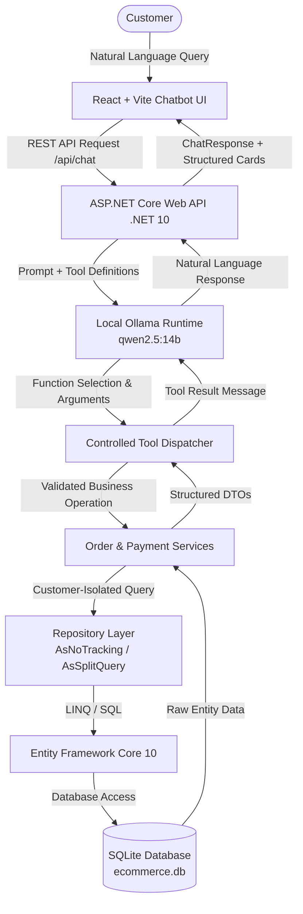

# AI-Powered E-Commerce Order Management Chatbot

An autonomous, locally-running AI assistant for e-commerce order management built from scratch with **React + Vite**, **ASP.NET Core Web API (.NET 10)**, **Entity Framework Core 10**, **SQLite**, and **Ollama (`qwen2.5:14b`)**.

Customers can interact with the order management system using natural language to track shipments, inspect line items, verify payment statuses, view chronological lifecycle history, and review recent orders.

---

## Architecture & Security Principles



### Core Security Principles
1. **Zero Direct LLM Database Access**: The LLM is never given a database connection, raw connection strings, or SQL capabilities. All database operations are strictly mediated by compiled .NET services and repositories.
2. **Customer Identity Isolation**: The LLM is never trusted to identify or claim which customer owns an order. Customer identity is established in the server request context and injected into repository filters (`o.CustomerId == customerId`), preventing cross-tenant data leakage.
3. **No Hallucinations Allowed**: The system prompt and tool architecture strictly mandate that the model communicates only factual data returned by backend business operations.

---

## Tech Stack

| Component | Technology | Description |
|---|---|---|
| **Frontend** | React 18 + Vite | Modern reactive chat interface with structured order cards |
| **Backend** | ASP.NET Core Web API (.NET 10) | Clean modular architecture with REST endpoints |
| **ORM** | Entity Framework Core 10 | SQLite provider with split queries and navigation includes |
| **Database** | SQLite | 7 relational tables with integer paise precision and UTC timestamps |
| **Local AI Runtime** | Ollama | 100% private, local inference without external API dependencies |
| **LLM Model** | `qwen2.5:14b` | State-of-the-art function calling and structured reasoning |
| **Icons & Styling** | Lucide React + Modern CSS | Responsive layout with animations and status indicators |

---

## Database Design

- **Customers**: Customer profile, code (`CUST-1001`), email, and status.
- **Products**: SKU catalogue with stock quantity and prices in paise.
- **Orders**: Orders with status, financial breakdowns in integer paise, and shipping address.
- **OrderItems**: Historical snapshots of products at purchase time (preserving pricing and names).
- **Payments**: Transaction records, references (`PAY-1002`), payment methods, and statuses.
- **Shipments**: Logistics carrier (`Delhivery`, `BlueDart`), tracking number, tracking URLs, and delivery dates.
- **OrderStatusHistory**: Chronological audit trail of order lifecycle changes.

---

## Backend Project Structure

```text
backend/OrderManger.API
├── Controllers
│   ├── ChatController.cs        # POST /api/chat (AI agent endpoint)
│   ├── OrdersController.cs      # GET /api/orders/* (Business REST APIs)
│   └── DatabaseController.cs    # GET /Database/Status (Health check)
├── AI
│   ├── Ollama                   # Typed Ollama HTTP client and JSON schemas
│   ├── Tools                    # Order tools registry and dispatching
│   └── ChatOrchestration        # Multi-turn tool-calling loop
├── Services
│   ├── Interfaces               # IOrderService contract
│   └── OrderService.cs          # Business logic and entity-to-DTO projection
├── Repositories
│   ├── Interfaces               # IOrderRepository contract
│   └── OrderRepository.cs       # EF Core data retrieval with isolation
├── DTOs
│   ├── Orders                   # OrderDetail, OrderSummary, Payment, Shipment DTOs
│   └── Chat                     # ChatRequest and ChatResponse contracts
├── Data
│   ├── Entities                 # EF Core scaffolded entity classes
│   └── OrderManagerDbContext.cs # Database context with foreign key enforcement
└── Program.cs                   # DI configuration, CORS, and HTTP pipeline
```

---

## API Endpoints

### AI Agent
- `POST /api/chat`: Natural-language customer query with automated backend tool calling.

### Order Management
- `GET /api/orders/{orderNumber}?customerId={id}`: Full order details with items, payment, shipment, and history.
- `GET /api/orders/recent?customerId={id}&limit=5`: Recent order summaries.
- `GET /api/orders/status/{status}?customerId={id}`: Orders filtered by status (`Shipped`, `Delivered`, `Pending`, etc.).
- `GET /api/orders/{orderNumber}/items?customerId={id}`: Order line items and product details.
- `GET /api/orders/{orderNumber}/payments?customerId={id}`: Payment transactions and statuses.
- `GET /api/orders/{orderNumber}/shipments?customerId={id}`: Shipment tracking numbers, carriers, and ETAs.
- `GET /api/orders/{orderNumber}/history?customerId={id}`: Complete chronological status history.

---

## Sample Test Customers

| ID | Code | Customer Name | Location | Sample Orders |
|---|---|---|---|---|
| **1** | `CUST-1001` | **Aarav Sharma** | Pune | `ORD-2026-1002` (Shipped), `ORD-2026-1001` (Delivered) |
| **2** | `CUST-1002` | **Priya Deshmukh** | Baner | `ORD-2026-1003` (Confirmed), `ORD-2026-1004` (Pending) |
| **3** | `CUST-1003` | **Rohan Patil** | Kothrud | `ORD-2026-1005` (Delivered), `ORD-2026-1008` (Processing) |
| **4** | `CUST-1004` | **Neha Kulkarni** | Wakad | `ORD-2026-1006` (Cancelled) |
| **5** | `CUST-1005` | **Aditya Joshi** | Hinjewadi | `ORD-2026-1007` (Shipped) |

---

## Quick Start Guide

### 1. Prerequisites
- macOS or Linux
- [.NET 10 SDK](https://dotnet.microsoft.com/download)
- [Node.js 18+](https://nodejs.org/)
- [Ollama](https://ollama.ai/) with `qwen2.5:14b`:
  ```bash
  ollama pull qwen2.5:14b
  ```

### 2. Start the Backend API
```bash
cd backend/OrderManger.API
dotnet run
```
*Listens on `http://localhost:5078`.*

### 3. Start the React Frontend
```bash
cd frontend
npm install
npm run dev
```
*Opens on `http://localhost:5173`.*

---

## Example Natural-Language Prompts

Try these in the chatbot UI:
- *"Where is my order ORD-2026-1002?"*
- *"Show me all my recent orders."*
- *"What products did I purchase in ORD-2026-1002?"*
- *"When will my order be delivered?"*
- *"Is my payment successful?"*
- *"Show my shipment tracking information."*
- *"What was the previous status of my order?"*
- *"Do I have any pending orders?"*
